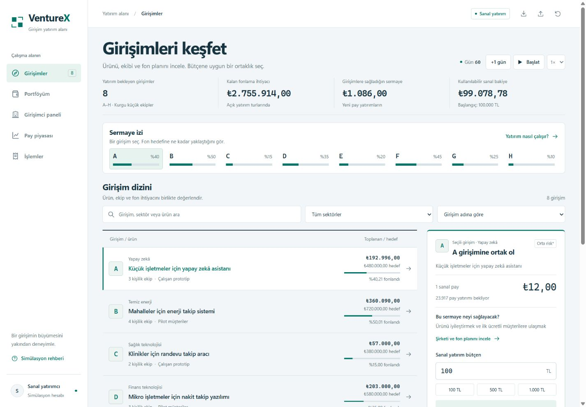

# VentureX

A browser-based simulation of startup funding and secondary share trading. Eight fictional startups compete for capital while investor agents submit orders to a price-time priority order book.

The interface is in Turkish. Amounts are displayed in TRY; the engine stores money as integer kuruş. All funds, businesses and market activity are simulated.



## Run locally

Requires Node.js 22 or newer. No dependencies or API keys are needed.

```sh
npm start
```

Open <http://127.0.0.1:4317>. To use another port, set `VENTUREX_PORT` before starting the server.

For a portable version:

```sh
npm run bundle
```

This creates `VentureX.html` in the project root. Open it directly in a browser; it contains the application, styles and simulation engine.

## Try a funding round

1. Compare the A–H campaigns in **Girişimler**, then select a startup.
2. Enter a budget. For example, 1,000 TL buys 83 new A shares at 12 TL each; 996 TL reaches the company and 4 TL remains unspent.
3. Check ownership and cost in **Portföyüm**, or inspect the company's funding plan in **Girişimci paneli**.
4. Advance the simulation with **+1 gün**. Revenue, expenses, investor expectations and submitted orders evolve each day.
5. Use **Pay piyasası** to trade existing shares with other investors. A sale needs a matching buyer; the last price is not a promise of liquidity.

## Model

Funding and secondary trading are separate accounting operations:

| Operation        | Cash destination | Share supply                                  |
| ---------------- | ---------------- | --------------------------------------------- |
| Funding campaign | Company treasury | New shares issued; existing ownership diluted |
| Secondary trade  | Selling investor | Unchanged                                     |

Prices change when secondary orders execute. The chart is built from those executions, including a 60-day preparation period before the user's session begins. Company performance affects investor decisions; it does not directly draw the chart.

Limit orders reserve cash or shares until filled or cancelled. Orders match by price, then submission time. Partial fills are supported. An unsupported market order is rejected without a partial execution. Bankruptcy cancels open orders and reduces the affected position's value to zero.

See [ARCHITECTURE.md](ARCHITECTURE.md) for the accounting rules, persistence checks and implementation boundaries.

## Check and test

```sh
npm run check
npm test
npm run bundle
```

The 24 engine tests cover matching priority, reservation and release, funding dilution, bankruptcy, deterministic replay, imported saves and a 365-day stress scenario. GitHub Actions runs syntax checks, tests and bundling on Node.js 22 and 24.

## Project layout

```text
dist/
  engine.js             Economic model, order matching and save validation
  app.js                UI state, SVG charts and browser persistence
  index.html            Accessible application shell
  styles.css            Layout and visual system
tests/
  engine.test.cjs       Accounting and exchange invariants
  funding.test.cjs      Campaign behavior and compatibility
  fixtures/             Legacy save used by compatibility tests
serve.cjs               Local static server
bundle.cjs              Standalone HTML generator
```

The engine runs in both the browser and Node.js. Rendering is kept outside the engine, so its accounting can be tested without a browser. The frontend uses plain JavaScript and inline SVG; there is no build framework or external chart service.

## Persistence and limitations

Sessions are stored in the current browser's local storage. JSON export/import moves a session between browsers. Imported state is validated before replacing the current simulation; invalid files leave the existing session intact.

Each browser runs its own market. There is no shared backend, user account system, payment processing or live market feed. Business revenue, expenses, risks and growth are simplified assumptions, not a calibrated valuation model. Portfolio market value becomes cash only through an executed sale. This application does not grant real investment or ownership rights.
